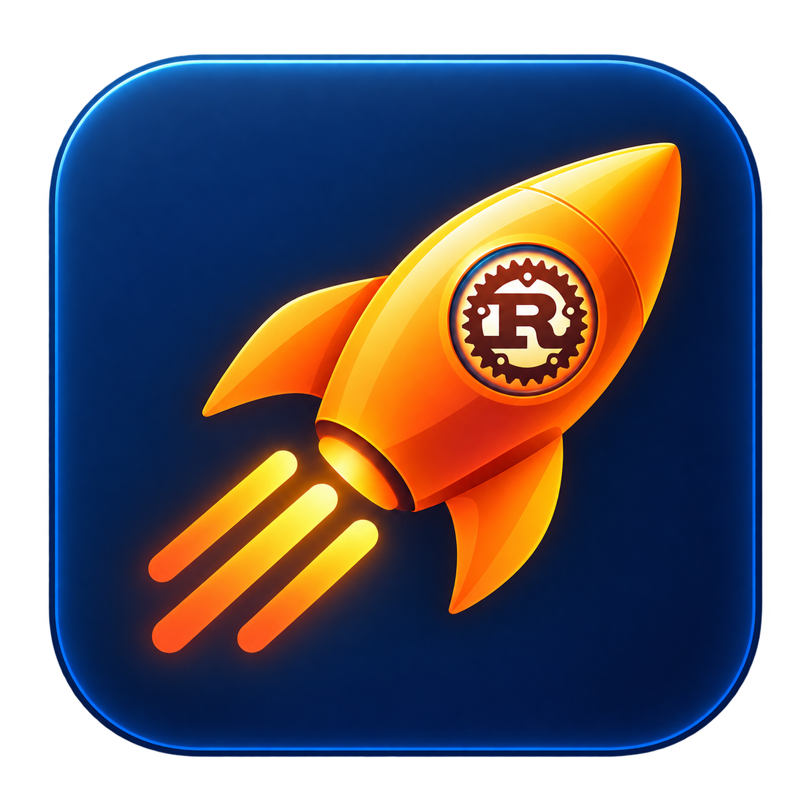

# Dashboard application icon



The icon combines the project's orange rocket, three message lanes, and a prominent Rust cog/R emblem on a navy tile. The master PNG preserves transparency outside the tile. The ICO is a mechanical multi-size export for Windows application resources.

`app-icon.ico` contains 16, 24, 32, 48, 64, 128, and 256 pixel RGBA variants resized from the unmodified PNG. The Windows build embeds the ICO as resource ID 1, which GPUI uses for the native window and taskbar icon.

Created with the built-in image generation tool. The project branding image `resources/RocketMQ-Rust-logo.png` was used as Rust identity reference for the final revision.

## Initial generation prompt

```text
Use case: logo-brand.
Asset type: production desktop app icon for RocketMQ Dashboard GPUI, the native Rust message-queue operations dashboard.
Primary request: design ONE polished, original, immediately recognizable application icon, supplied as a square 1024 x 1024 PNG master. It should be attractive on a Windows taskbar and macOS/Linux app launcher and remain clear at 32px.
Design: a bold simplified warm orange rocket pointing diagonally toward the upper right, its two or three short exhaust trails stylized as orderly message-queue lanes. A single small luminous cyan circular viewport subtly suggests monitoring. Use the existing project's warm orange/yellow rocket visual DNA, but create a fresh, restrained native application mark. Do not include the Rust R gear or any lettering.
Background: a deep midnight navy rounded-square tile, generous rounded corners, subtle edge highlight and very shallow dimensionality. The tile occupies about 90 percent of the canvas with consistent transparent clearance outside it. Outside the tile must be real transparent alpha, not a checkerboard or white background.
Style: premium, crisp, geometric, restrained satin finish, strong silhouette, warm orange-to-amber highlights and a restrained cyan accent. Minimal depth, no photoreal scene.
Composition: one centered icon only, balanced internal padding, large simple shapes, no detached decorative objects. The flame and rocket must fit safely inside the tile.
Constraints: no words, letters, numbers, watermark, labels, device mockup, grid, collage, alternate designs, chart panels, tiny nodes or hairline detail. No checkerboard pattern, no surrounding backdrop, no exaggerated glow. Deliver the final clean app-icon artwork, not a presentation of the design.
```

## Final Rust emphasis prompt

```text
Edit target: Image 1, the generated RocketMQ Dashboard app icon.
Reference only: Image 2, existing RocketMQ-Rust branding. Use only its recognizable Rust cog/gear with the R monogram as identity guidance; do not copy its surrounding rocket, white background, checkerboard or glossy illustration style.

User request: make the Rust identity prominently visible.
Replace the cyan circular rocket porthole in Image 1 with a large, highly legible Rust emblem: a crisp white R monogram inside a charcoal/rust-brown toothed cog badge, with a very restrained cool rim for contrast. The gear silhouette and R must unmistakably read as Rust. Make this emblem prominent, about one-third of the rocket's body width or slightly larger, so the R remains recognizable when the app icon is small. Use the Rust-style bold slab R and cog silhouette from Image 2, not generic text or another language's logo.

Preserve Image 1's composition, orange-to-amber rocket pointing upper-right, three short message-lane exhaust trails, midnight navy rounded-square tile, safe padding and polished native-app treatment. Preserve actual transparent alpha outside the tile. Integrate the Rust badge naturally into the rocket body without extra floating logos.
No other text, no wordmarks, no watermark, no grid/checkerboard, no alternate designs, no collage, no extra decorative nodes. Deliver one finished square app icon.
```
