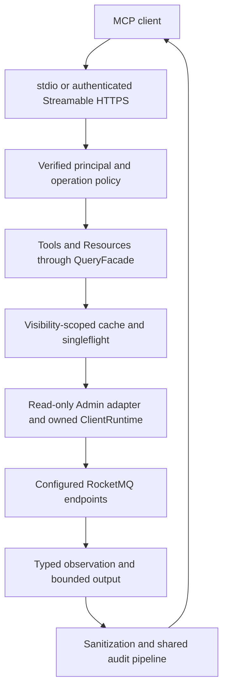

# Read-only MCP diagnostics

Certificate and Secret provisioning, HTTPS/JWKS trust, and outbound TLS limits are covered in the [TLS guide](../deployment/tls.md#mcp).

`rocketmq-mcp` is a standalone Model Context Protocol server for RocketMQ queries, diagnosis and runbook prompts. It runs outside Broker, NameServer and Dashboard processes and uses Admin Core's `read-client-adapter`. Its default tools do not open mutation sessions. The optional planning feature produces proposals; it does not apply them.

## Request path and ownership



The MCP process owns its lifecycle, query runtime, cache and asynchronous audit writer. Shutdown closes admission, drains accepted audit records, flushes the sink and closes owned tasks against a deadline. A cached observation describes when data was observed, not a new remote read or a guarantee that the cluster has not changed.

## Build the selected transport

From the repository root, enter the standalone project:

```bash
cd rocketmq-ai/rocketmq-mcp
cargo build --locked --release
```

The default features are `read-only`, `diagnose` and `stdio`. In that same directory, an HTTPS build can use:

```bash
cargo build --locked --release --features streamable-http
```

`streamable-http` includes the authentication feature; it is not an unauthenticated HTTP mode. `observability` enables in-process signals, while `otlp` selects the implemented OTLP gRPC support. `change-planning` adds five planning tools subject to runtime policy; the feature is deprecated and will be removed, and a change is planned with a dry run of [MCP Control](./mcp-control.md) instead. `security-admin` adds one read-only tool, `rocketmq_list_acl_users`, which lists the ACL users of a cluster without their passwords; a call also needs the scope `rocketmq:security-admin` and a role that holds the tool. None of these features turns Query MCP into MCP Control.

The binary is `target/release/rocketmq-mcp`, or `rocketmq-mcp.exe` on Windows. Root-workspace `cargo build` does not build this standalone package. Native dependencies come from its selected dependency graph; see [features/platforms](../reference/features-platforms.md).

## Prepare a local stdio configuration

Copy [conf/mcp.example.toml](https://github.com/mxsm/rocketmq-rust/blob/main/rocketmq-ai/rocketmq-mcp/conf/mcp.example.toml) to your own configuration file. Keeping it in the same `conf` directory preserves the example's relative permission-file path; when moving it elsewhere, also copy the policy file and deliberately resolve audit/TLS references. Choose a new filename rather than replacing an existing operator configuration.

For the first-message development cluster, edit the existing cluster entry to these values instead of appending another default cluster:

```toml
[[clusters]]
name = "local-dev"
rocketmq_cluster_name = "DocsCluster"
namesrv_addr = "127.0.0.1:9876"
default = true
```

This is a replacement fragment, not a complete configuration. Remove unused sample Proxy/Controller aliases or set them to the real services you intend to query. A logical MCP cluster name can differ from the physical RocketMQ cluster name. Tools take configured logical aliases rather than arbitrary network addresses.

| Setting | Checked-in example / behavior |
| --- | --- |
| `security.profile` | `diagnose` for local diagnosis scope |
| `security.allow_change_planning` | `false`; compilation alone cannot allow planning calls. Deprecated with the `change-planning` feature |
| `security.permissions_file` | `permissions.example.toml`, loaded relative to the config file |
| `security.sanitize_output` | `true` |
| `security.max_concurrent_requests_per_cluster` | 8 |
| `security.rate_limit_per_minute` | 60 per principal/cluster/operation; the budget refills evenly, one call every `60 / limit` seconds |
| `security.http_rate_limit_per_minute` | Unset; HTTP requests per principal, counted apart and ten times `rate_limit_per_minute` by default. A refused request gets HTTP 429 with `Retry-After` |
| `security.pseudonym_key_env` | Unset; names an environment variable holding a 32–1024 byte key so that restarts and replicas return the same client and message pseudonyms |
| `audit.enabled` / `sink` | `true` / `file`; choose a writable audit path. A record names the Topic, Consumer Group and Broker a call asked about, never a message |
| `audit.max_file_bytes` | 67108864 (64 MiB); the file sink seals the audit file at this size as `<path>.000001`, `<path>.000002`, ... and never deletes a sealed file. `0` keeps one file |
| `cache.enabled` / `max_entries` | `true` / 256; per-query TTLs govern freshness |
| `server.request_timeout_ms` | 25000; the time one request may spend on RocketMQ sources over every query it runs, from 1000 to below 30000 |
| `server.stdio.log_to_stderr` | `true`; stdout is reserved for MCP frames |

An unknown key in the configuration file or the permissions file stops startup. The error names the key and the table that holds it and never a configured value; only the `[logging]` table still ignores unknown keys.

Start from the MCP directory after editing `conf/mcp.local.toml`:

```bash
cargo run --locked -- --config conf/mcp.local.toml --transport stdio
```

Configure your local MCP client to launch the built binary with those arguments and an explicit absolute config path. Stdio is a local-development process integration; a terminal waiting for protocol input is not an HTTP server. Do not prepend shell banners or redirect diagnostic text into stdout.

The config path is required through `--config` or `ROCKETMQ_MCP_CONFIG`. Permission, TLS, JWKS CA and audit paths resolve relative to the config file. The CLI currently assigns its `--transport` value after loading the file, and that argument defaults to `stdio`. Always pass `--transport streamable-http` explicitly for HTTPS; setting only `server.transport` in the file is insufficient for this CLI path. Optional `--bind` and `--endpoint` override their corresponding file values.

## Streamable HTTPS and identities

HTTPS requires the compiled transport, a readable certificate/private-key pair, an allowed origin policy and authentication configuration. The example listens on `127.0.0.1:8089` with endpoint `/mcp` and public base URL `https://127.0.0.1:8089`. These defaults do not supply actual certificate files or credentials.

| Boundary | Identity and configuration |
| --- | --- |
| Local development HTTP | `development-token` is restricted to loopback development; the token is read through the configured environment reference. |
| Production HTTP | `oauth-jwt` validates RS256 tokens with `kid`, signature, issuer, audience, expiry and required scopes against HTTPS JWKS. |
| Private JWKS CA | Configure `jwks_ca_path` with a readable PEM trust bundle; relative paths belong to the config directory. |
| Tool execution | Verified roles/scopes, configured clusters, cluster claims, tenant binding, rate limits and operation policy apply at their defined stages. |
| Outbound RocketMQ | Separate request-signing credentials from configured file/environment references; the incoming bearer token is never forwarded. |

Production OAuth has no static `jwt_key_env` fallback. Key refresh failures preserve an already verified generation within the configured stale window. The protected-resource metadata endpoint is intentionally available without a bearer token for discovery. The MCP endpoint itself remains authenticated.

A JWKS entry is used when it is an RSA key of 2048 to 8192 bits with exponent 65537 whose `use` is absent or `sig` and whose `alg` is absent or `RS256`. Other entries, such as encryption keys, and members such as `x5c` are ignored, so the documents of common identity providers work as published. A token naming an unknown `kid` triggers one JWKS fetch; while the key is still missing, the next fetch waits five seconds. A bearer token above 16 KiB is rejected before it is parsed.

After configuring these materials, launch from the MCP directory:

```bash
cargo run --locked --features streamable-http -- --config conf/mcp.local.toml --transport streamable-http --bind 127.0.0.1:8089 --endpoint /mcp
```

An HTTP-capable MCP client connects to the HTTPS endpoint and sends its authorization header and `Accept: application/json, text/event-stream`. Certificate validation, protocol initialization and the session/stream lifecycle belong to the MCP client. A bare unauthenticated GET is not a complete tool invocation.

RocketMQ signing credentials must be separate from HTTP identity. A configured YAML credential file contains `access_key`, `secret_key` and optional `security_token` and is bounded to 64 KiB. Alternatively, configure environment-variable references. Inline secret values and mixed file/environment sources are rejected. Credentials are resolved at startup and for new read sessions, supporting mounted-secret rotation. Grant the Broker identity only the required read access.

## Discover and call tools

The checked-in protocol version is `2025-11-25`; initialization rejects another version, and over Streamable HTTP a request whose `MCP-Protocol-Version` header names another version gets HTTP 400 `unsupported_protocol_version`. After initialization, use `tools/list` for the caller-visible catalog. The source default catalog contains 36 tools, but policy can reduce discovery.

| Query family | Default tool names |
| --- | --- |
| Cluster / inventory | `rocketmq_list_clusters`, `rocketmq_list_brokers`, `rocketmq_get_cluster_overview`, `rocketmq_list_topics`, `rocketmq_list_consumer_groups` |
| Topic | `rocketmq_describe_topic`, `rocketmq_get_topic_route`, `rocketmq_get_topic_config_state`, `rocketmq_get_topic_stats`, `rocketmq_get_topic_config`, `rocketmq_list_topic_consumers` |
| Consumers / connections | `rocketmq_get_consumer_lag`, `rocketmq_list_consumer_connections`, `rocketmq_list_producer_connections`, `rocketmq_get_consumer_group_config_state`, `rocketmq_get_consumer_group_details`, `rocketmq_get_consumer_progress`, `rocketmq_get_consumer_running_info`, `rocketmq_get_dlq_summary` |
| Broker | `rocketmq_describe_broker`, `rocketmq_get_broker_diagnostics`, `rocketmq_get_broker_config_summary`, `rocketmq_get_broker_log_filter_state`, `rocketmq_get_lite_broker_info` |
| Infrastructure | `rocketmq_get_proxy_drain_state`, `rocketmq_get_ha_status`, `rocketmq_get_controller_metadata`, `rocketmq_get_nameserver_config_summary` |
| Message | `rocketmq_get_message_metadata`, `rocketmq_query_message_trace`, `rocketmq_find_messages_by_key` |
| Diagnosis | `rocketmq_diagnose_consumer_lag`, `rocketmq_diagnose_consumer_group`, `rocketmq_diagnose_message_delivery`, `rocketmq_diagnose_broker_health`, `rocketmq_get_cluster_health` |

`rocketmq_diagnose_consumer_lag` reads its evidence in one admin session: the lag of every queue, the connections and configuration of the group, the route and permissions of the topic, the Broker that holds the most lag, and the retry and dead-letter topics of the group. It grades the backlog by its size and by how far behind production the group is, so the same number of waiting messages is `low` on a busy topic and `critical` on a quiet one. Each root cause carries a stable `rule_id`, for example `no_online_consumer`, `consumption_disabled`, `read_permission_missing` or `retry_queue_growing`, and names the evidence it rests on. A read that fails becomes missing evidence in a partial report instead of failing the diagnosis. The thresholds are server-owned settings under `[diagnosis]`, and `[[diagnosis.overrides]]` replaces them for single topics and consumer groups.

Four more diagnosis tools return the same report shape. `rocketmq_get_cluster_health` checks a cluster at a glance and names the Brokers to look at first; `rocketmq_diagnose_broker_health` checks one Broker, its master and its replicas; `rocketmq_diagnose_consumer_group` explains the backlog of one consumer group over every topic it consumes; and `rocketmq_diagnose_message_delivery` checks the path from one topic to one consumer group and, given a message identifier, says whether the group consumed that message, still waits for it, retries it or dead-lettered it. A health report is as severe as its worst finding. Naming a message also requires the permission for `rocketmq_get_message_metadata`; the report names the message by a pseudonym and never contains its body.

Use a simple explicit-cluster query first. This is a `tools/call` request for an already initialized MCP session, not a standalone HTTP command:

```json
{
  "jsonrpc": "2.0",
  "id": 2,
  "method": "tools/call",
  "params": {
    "name": "rocketmq_list_topics",
    "arguments": {"cluster": "local-dev", "limit": 25}
  }
}
```

`limit` is 1–200 and defaults to 50. Follow the opaque `data.next_cursor` while `has_more` is true; do not invent a cursor or treat it as a queue offset. Supply the same logical target, corresponding query parameters and `limit`. A cursor continues one result that the server keeps for 60 seconds by default, so every page comes from the same observation. See the [complete Tool Reference](https://github.com/mxsm/rocketmq-rust/blob/main/rocketmq-ai/rocketmq-mcp/docs/tool-reference.md) for exact schemas and per-tool output.

Discovery checks scopes and Tool allow/deny policy; it does not establish that a particular cluster/tenant call is authorized. The two inventory tools allow an omitted cluster and then use the default cluster, or the only configured one. That cluster goes through the same per-cluster and tenant checks, rate limit and concurrency limit as an explicitly named cluster; an empty or whitespace-only cluster is rejected as `invalid_arguments` by every tool. Prefer explicit clusters in operational clients so that a call never depends on which cluster is the default.

The server also answers `completion/complete` for Prompt arguments and Resource template variables that name a cluster, Topic, Consumer Group or Broker. Candidates are prefix matches, at most 100, and need the permission of the matching listing tool; a Topic, group or Broker is completed only inside the cluster already present in the completion context. An unauthorized or unanswerable completion returns an empty list.

## Interpret observations, partial data and failures

Successful calls carry a `rocketmq-mcp.v2` envelope with request ID, logical cluster, observation time, freshness, cache status, partial flag, warnings and typed data. The list Tools accept `response_format`: `detailed` (default) returns every field of each item, `concise` only the fields that name it, which keeps a search for a name small. `hit`, `miss` and `bypass` distinguish query reuse. Requests that waited for the same read share its result or its failure, and a `source_unavailable` failure answers identical requests for at most one second; no other failure is kept. With `cache.stale_if_error_ms` set, a result past its TTL answers while the source is unavailable and carries the warning `stale_cache_value` with its real age. Query state and continuation cursors are separated into `standard` and `sensitive` visibility classes; state does not cross that class boundary.

Output arrays are bounded to 1,000 rows and structured output to 1 MiB. Truncation and source failures can produce partial results. Inspect warnings and `partial` before presenting an observation as complete. Message metadata tools omit bodies, and connection identities are pseudonymous; missing sensitive values are not necessarily a backend failure. A pseudonym is a keyed hash of the identifier: it is stable within one server process, and across restarts and replicas only when `security.pseudonym_key_env` supplies a shared key.

| Symptom/code | Next action |
| --- | --- |
| Missing tool | Inspect compiled feature, principal scope and Tool policy; planning additionally needs runtime permission at call time. |
| `unauthorized_scope` / `cluster_not_allowed` / `tenant_mismatch` | Check verified identity and configured policy; changing the query alias cannot grant access. |
| `invalid_arguments` | Read `violations` when present: up to three entries, each a JSON Pointer `path` into the arguments and a `constraint` such as `required`, `maximum` or `additional_property`. Fix those arguments against the Tool's input schema; a sent value is never echoed back. |
| `not_found` | The request was valid but the target named by `entity` does not exist in the selected cluster. Do not retry; confirm the name with the matching list tool. |
| `source_unavailable` | Check the MCP process's route to configured NameServer/Broker/Proxy/Controller endpoints and outbound read credentials. |
| `backend_timeout` | The request used up `server.request_timeout_ms`. Retry a narrower query and check which source is slow. |
| `rate_limited` | Wait the `retry_after_ms` the error names, then retry; avoid multiplying retries across the AI client and MCP layer. |
| `concurrency_limited` | The cluster serves as many requests as `security.max_concurrent_requests_per_cluster` allows. Retry shortly, and run fewer queries on that cluster at once. |
| `cursor_expired` | The kept result is gone. Request the first page again without `cursor`. |
| `cursor_invalid` | Resend the cursor exactly as received, with the arguments and `limit` of the request that returned it. |
| `result_too_large` | The result exceeds the 10,000 rows or 4 MiB kept for paging. Narrow the request, for example with `filter`. |
| `output_too_large` or partial warning | Narrow the query, paginate where supported and preserve the warning in the diagnosis. |
| Stale observation | Inspect observation time, TTL/cache status and selected cluster before inferring a current outage. |
| stdio parse failure | Confirm protocol version and clean stdout; inspect stderr for redacted startup/transport diagnostics. |

Planning tools, when enabled, generate create-topic, update-topic-config, update-topic-permissions, update-Broker-config and reset-offset plans. They contain no Apply mode and call no mutation API. Execution belongs to separately designed operator/control workflows, not this diagnostic process. These planning tools are deprecated: a dry run of [MCP Control](./mcp-control.md) plans the same changes against the state they would be applied to, and each planning tool's description names the control tool that replaces it.

This guide was checked against configuration, registration and protocol sources, with TOML/JSON and website rendering checks. It does not claim a live MCP-client session, OAuth/JWKS deployment or external-cluster diagnosis was tested during documentation writing.

Sources: [configuration parser](https://github.com/mxsm/rocketmq-rust/blob/main/rocketmq-ai/rocketmq-mcp/src/config.rs), [entry point](https://github.com/mxsm/rocketmq-rust/blob/main/rocketmq-ai/rocketmq-mcp/src/main.rs), [tool catalog](https://github.com/mxsm/rocketmq-rust/blob/main/rocketmq-ai/rocketmq-mcp/src/tools/catalog.rs), [protocol server](https://github.com/mxsm/rocketmq-rust/blob/main/rocketmq-ai/rocketmq-mcp/src/protocol/server.rs), [permission example](https://github.com/mxsm/rocketmq-rust/blob/main/rocketmq-ai/rocketmq-mcp/conf/permissions.example.toml), [read-only boundary](https://github.com/mxsm/rocketmq-rust/blob/main/rocketmq-ai/rocketmq-mcp/AGENTS.md).
